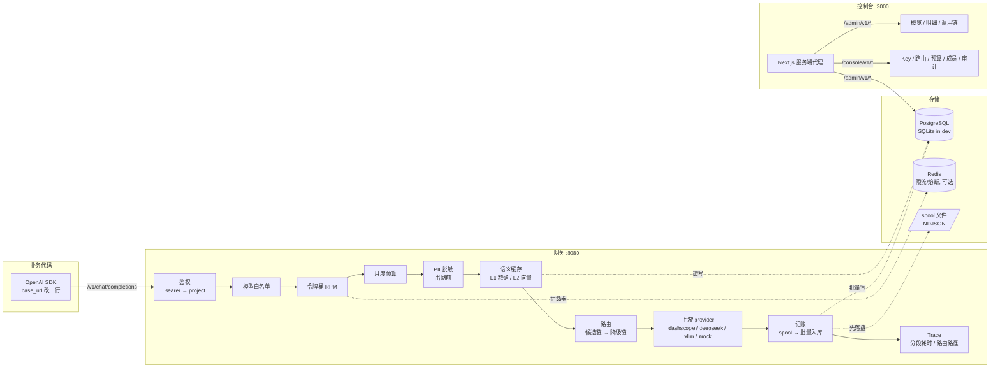

# 架构

一页看懂：请求怎么走、状态存在哪、想改哪块该动哪个文件。设计取舍的理由在
[`docs/adr/`](docs/adr/)，这里只讲结构。



图上那个 "OpenAI SDK 改一行 base_url" 指的是**文本补全**用法。`tools` / `response_format`
不在兼容面内：它们没有转发路径，入口就 400（`schemas.SUPPORTED_PARAMS` 是唯一白名单）。

## 一次请求的十道关

| # | 阶段 | 代码 | 失败时 |
|---|---|---|---|
| 1 | 参数白名单（不在名单里的字段一律拒绝，不静默丢） | `v1_chat._reject_unsupported_parameters` | 400 `unsupported_parameter` / `invalid_parameter` |
| 2 | 鉴权：`sk-ag-...` → key → project | `security.py` + `api/deps.py` | 401 `invalid_api_key` |
| 3 | 模型白名单（key 级） | `v1_chat._check_model_scope` | 403 `model_not_allowed` |
| 4 | 项目状态 | `v1_chat` 开头 | 403 `project_paused` |
| 5 | 限流（项目级令牌桶） | `core/quota.py` | 429 `quota_exceeded` + `Retry-After` |
| 6 | 月度预算硬限 | `core/quota.check_budget` | 429 `budget_exhausted` |
| 7 | PII 脱敏（身份证→手机→银行卡→邮箱） | `guard.py` | 不失败，只掩码并计数 |
| 8 | 语义缓存（仅 `temperature=0`、单轮、非流式） | `core/cache.py` | 命中则 `cost=0` 返回 |
| 9 | 路由：候选链 → 降级链，只对可重试错误降级 | `v1_chat` + `core/circuit.py` | 全挂 → 502 `no_candidate` |
| 10 | 记账 + Trace | `metering_queue.py` / `request_traces` | 记账不阻塞响应 |

第 1 关在最前面是有意的：`tools` / `response_format` 这类没有转发路径的字段，如果走到
第 5 关之后才发现，就会既花掉配额又留下账单，而调用方只看到 400——现在它连限流计数都不碰。

**5/6/7 的顺序不能换**：限流和预算命中时不写账单（它们在落库之前 return），所以报表
次数天然小于客户端调用次数——这是设计，不是丢数据。`runbook.md` 第 0 节把这条写成值班必读。

## 状态存在哪里

| 状态 | 位置 | 多副本时 |
|---|---|---|
| 租户 / key / 预算 / 路由 / 账单 | PostgreSQL | ✅ 共享 |
| 限流计数、熔断状态 | 进程内存（或 Redis） | ⚠️ `memory` 后端下每副本一份 |
| 记账待提交队列 | spool 文件 + 内存队列 | ⚠️ 每副本自己的 spool |
| 控制台会话 | 签名 cookie（HMAC） | ✅ 无状态 |
| 语义缓存向量 | JSON 列 + 暴力余弦（万级） | ✅ 共享，pgvector 可替换 |

一句话：**能放数据库的都放了；留在内存里的两个（限流、熔断）就是"不能多副本"的全部原因。**

## 模块地图

```
src/aigate/
├── main.py              app 工厂；中间件顺序 = request_id → 审计 → 路由
├── config.py            pydantic-settings，前缀 AIGATE_；含生产环境启动校验
├── db.py                engine/session 工厂；SQLite 自动 WAL + busy_timeout
├── models.py            14 张表（见下）
├── schemas.py           OpenAI 兼容的请求/响应形状 + `SUPPORTED_PARAMS` 白名单
├── security.py          key 生成与 SHA-256（明文只返回一次）
├── guard.py             4 条 PII 正则，顺序敏感
├── metering.py          Decimal 成本、token 估算、价目表查询
├── metering_queue.py    记账：spool → 批量 executemany → ack → 回放去重
├── metrics.py           Prometheus 文本指标
├── console_auth.py      scrypt 口令、HMAC 会话、Actor、角色序
├── audit.py             只追加审计；actor 来自 request.state
├── api/
│   ├── v1_chat.py       数据面（1072 行，就是上面那十道关）
│   ├── admin.py         控制面读：overview/usage/trace/keys/projects/models/audit
│   ├── admin_ops.py     控制面写：预算/限流/路由/CSV 导出
│   ├── console_auth.py  登录、成员、改密
│   └── deps.py          Principal / Actor / require_admin
├── core/
│   ├── quota.py         令牌桶（memory|redis）+ 预算检查
│   ├── circuit.py       按 provider 的熔断：closed → open → half-open
│   ├── cache.py         L1 精确 + L2 向量，租户隔离
│   └── embedding.py     embedder 抽象；阈值挂在模型上
└── providers/
    ├── base.py           BaseProvider 抽象（chat / stream）
    ├── openai_compat.py  一家实现，三家复用（dashscope/deepseek/vllm）
    ├── mock.py           离线 provider，可注入 fail500 / 慢流
    └── __init__.py       注册表，懒加载
```

## 数据模型

| 表 | 作用 | 关键约束 |
|---|---|---|
| `teams` / `projects` | 租户与项目 | `(team_id, slug)` 唯一 |
| `api_keys` | key（只存 SHA-256） | `key_hash` 唯一；明文不落库 |
| `model_prices` | 单价表 | `(provider, model)` 唯一 |
| `route_policies` | 虚拟模型 → 候选链 | `match_model` 唯一 |
| `usage_records` | **账单**，一行一次上游调用 | 缓存命中也有行，`cost=0` |
| `request_traces` | 排查用：分段耗时、路由路径 | `request_id` 唯一 |
| `semantic_cache_entries` | L1/L2 缓存 | 按 `tenant+model+prompt_version` |
| `console_users` | 控制台账号（scrypt） | `email` 唯一 |
| `audit_logs` | 写操作审计 | 只追加，无删除接口 |

账单与 Trace 分表的理由：**一个问题一个真相**。钱的问题查 `usage_records`，性能的问题查
`request_traces`。合成一张表会让「这个月花了多少」和「这条为什么慢」互相污染。

## 想改什么，动哪里

| 需求 | 动哪里 |
|---|---|
| 接一家新供应商 | `providers/__init__.build_provider` 加一个分支 + `model_prices` 插行 |
| 加一种 PII 规则 | `guard.py` 的正则表（注意顺序：长模式在前） |
| 改路由算法（如按价格优先） | `v1_chat` 里 `strategy` 分支；`core/` 有测试夹具 |
| 换向量库 | 实现 `core/embedding.py` 的接口 + `cache.py` 的 VectorStore |
| 加一个控制台页面 | `console/app/(shell)/<name>/page.tsx` + `admin.py` 一个只读接口 |
| 改记账口径 | `metering.py`（成本）+ 对应测试；**必须同步 `docs/runbook.md`** |

## 不在这里的东西

RAG 检索、文档解析、Agent 编排都不是网关的职责——它们跑在网关**上面**，通过
`base_url` 接进来。把上层应用的指标（召回率、答案准确率）塞进网关，面试时一句
「你这个网关的召回率怎么算」就问穿了。