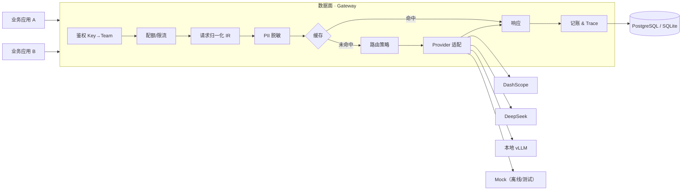

# AIGate

[](https://github.com/Wind-fat/aigate/actions/workflows/ci.yml)
[](LICENSE)
[](pyproject.toml)

**多租户 LLM 网关**：统一接入 · 按团队记账 · 路由与降级 · 可观测 · 质量门禁。

> 业务方只改一行 `base_url`，就获得了鉴权、配额、成本归因、故障降级和全链路追踪。
> AIGate 不是聊天工具——它没有聊天界面。它是一个公司**管理大模型资源**的那一层。

| 指标 | 目标 | 状态 |
|---|---|---|
| 网关附加延迟（P95，剔除上游） | < 30 ms | 🚧 压测中 |
| 记账与厂商账单偏差 | < 2 % | 🚧 Stage 3 |
| 降级成功率 | ≥ 98 % | 🚧 Stage 2 |
| 评审门禁通过率阈值 | 95 % | 🚧 Stage 4 |

---

## 为什么不是套壳

判断标准只有一条：**把底层模型换掉，谁会死？**

| | 套壳工具 | AIGate |
|---|---|---|
| 产出物 | 一个聊天界面 | 治理能力（配额 / 账单 / 降级 / trace） |
| 换模型 | 改代码、改 prompt | 改一行路由映射，业务侧无感 |
| 有没有多租户 | 没有 | 团队 → 项目 → Key 三级 |
| 能不能被审计 | 不能 | 每次调用可追溯到成本与责任人 |
| 失败模式 | 答案不好 | 账算错、权限漏、降级不生效 |

---

## 架构



**请求路径**：`鉴权 → 模型白名单 → 路由解析（主候选 + 显式 fallback）→ Provider 调用 → 成本计算 → 记账 + Trace → 响应（含 x_aigate 元数据）`

每个响应的 `x_aigate` 块把「成本 / 缓存 / 降级 / 耗时」变成协议级事实，调用方无需改造即可判断答案来路：

```json
"x_aigate": {
  "request_id": "req_7f3c1a...",
  "team": "acme", "project": "support-bot",
  "provider": "mock", "model_requested": "chat-default", "model_used": "mock-ok",
  "degraded": false, "cache_hit": null,
  "cost_cny": 0.000042, "priced": true,
  "latency_ms": { "scope_ms": 0, "upstream_ms": 12, "gateway_total": 14 }
}
```

---

## 快速开始

**前置**：Python ≥ 3.11、[uv](https://github.com/astral-sh/uv)。无需 Docker、无需数据库服务（默认 SQLite）。

```bash
git clone <your-repo> && cd aigate
uv sync --all-groups
cp .env.example .env
uv run python scripts/seed.py     # 建示例租户、模型单价、路由策略，并打印 demo key
uv run uvicorn aigate.main:app --port 8080
```

**发一个请求**（用上一步打印的 key）：

```bash
curl -s http://127.0.0.1:8080/v1/chat/completions \
  -H "Authorization: Bearer sk-ag-xxxxx" \
  -H "Content-Type: application/json" \
  -d '{"model":"chat-default","messages":[{"role":"user","content":"你好"}]}' | jq
```

OpenAPI 文档：<http://127.0.0.1:8080/docs>

### 演示故障降级（无需真实 API key）

```bash
# failover-demo 的主候选被故意配置成返回 500，网关应自动降级到备用模型
curl -s http://127.0.0.1:8080/v1/chat/completions \
  -H "Authorization: Bearer sk-ag-xxxxx" \
  -H "Content-Type: application/json" \
  -d '{"model":"failover-demo","messages":[{"role":"user","content":"hi"}]}' | jq '.x_aigate'
# => "degraded": true, "model_used": "mock-ok"
```

---

## 接入真实模型

改 `.env`，把某个候选指向真实供应商（三家都走 OpenAI 兼容协议，一个适配器即可）：

```bash
AIGATE_DEFAULT_PROVIDER=dashscope
AIGATE_DASHSCOPE_API_KEY=sk-xxx
```

然后在 `route_policies` 里把候选改成 `{"provider":"dashscope","model":"qwen-plus"}`。
没有真实 key 时，`mock` provider 保证整套链路（鉴权、路由、降级、记账、trace）**始终可运行**——这也是它存在的理由。

---

## API

| 方法 | 路径 | 说明 | 鉴权 |
|---|---|---|---|
| POST | `/v1/chat/completions` | OpenAI 兼容对话接口 | Bearer API Key |
| GET | `/v1/models` | 当前 Key **有权调用**的模型 | Bearer API Key |
| GET | `/health` | 存活探针 | 无 |
| GET | `/ready` | 就绪探针（含 DB） | 无 |
| GET | `/metrics` | Prometheus 文本指标 | 无 |

**错误码统一**，调用方据此决策而不必读文档：

```
gateway.missing_credentials / gateway.invalid_key / gateway.model_not_allowed
gateway.quota_exceeded / gateway.stream_not_implemented
upstream_timeout / upstream_5xx / upstream_4xx / upstream_rate_limited
```

---

## 配置（环境变量，前缀 `AIGATE_`）

| 变量 | 默认 | 说明 |
|---|---|---|
| `AIGATE_DATABASE_URL` | `sqlite+aiosqlite:///./aigate.db` | 生产用 `postgresql+asyncpg://...` |
| `AIGATE_ADMIN_TOKEN` | `dev-admin-token` | 控制面管理令牌 |
| `AIGATE_DEFAULT_PROVIDER` | `mock` | 无匹配路由时的兜底 provider |
| `AIGATE_REQUEST_TIMEOUT_S` | `30` | 上游超时（秒） |
| `AIGATE_DASHSCOPE_BASE_URL` / `_API_KEY` | — | 阿里云百炼（OpenAI 兼容模式） |
| `AIGATE_DEEPSEEK_BASE_URL` / `_API_KEY` | — | DeepSeek |
| `AIGATE_VLLM_BASE_URL` / `_API_KEY` | `127.0.0.1:8000/v1` | 本地 vLLM（私有化路线） |

---

## 测试

```bash
make verify        # ruff + pytest
make test          # 仅测试
```

测试全部走 `mock` provider，不触网、不需要 key、可离线跑。

```
tests/
├── test_security.py        # key 生成 / 哈希 / 格式
├── test_metering.py        # Decimal 成本计算、token 估算、PII 脱敏
└── test_chat_endpoint.py   # 鉴权 401 / 模型越权 403 / 降级 / 非重试错误 / 记账一致性
```

---

## 目录

```
src/aigate/
├── main.py            # app 工厂、中间件顺序、异常归一化
├── config.py          # 所有配置唯一入口
├── db.py              # 引擎懒加载（测试可换库）
├── models.py          # 7 张表：租户 / Key / 单价 / 路由 / 账单 / Trace
├── security.py        # API Key 生成与 SHA-256 存储
├── metering.py        # Decimal 成本计算、token 估算、PII 脱敏
├── metrics.py         # Prometheus 文本指标
├── providers/         # base(ABC) + openai_compat(三家共用) + mock(离线)
└── api/               # deps / health / v1_chat
```

---

## Roadmap

- [x] **Stage 1** 骨架、鉴权、路由、降级、记账、Trace、测试
- [ ] **Stage 2** 配额与限流（Redis 令牌桶）、流式 SSE、PII 中间件、熔断
- [ ] **Stage 3** 语义缓存（pgvector）、成本看板、控制台
- [ ] **Stage 4** 评测集 + CI 门禁 + 私有化部署文档

设计决策见 [`docs/adr/`](docs/adr/)。

---

## License

Apache-2.0