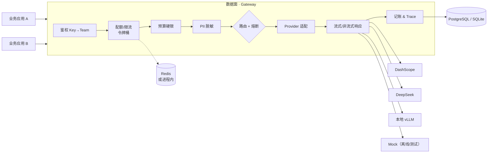

# AIGate

[](https://github.com/Wind-fat/aigate/actions/workflows/ci.yml)
[](LICENSE)
[](pyproject.toml)

**多租户 LLM 网关**：统一接入 · 按团队记账 · 路由与降级 · 熔断 · 流式透传 · 脱敏 · 可观测。

> 业务方只改一行 `base_url`，就获得鉴权、配额、成本归因、故障降级和全链路追踪。
> AIGate 不是聊天工具——它没有聊天界面。它是一个公司**管理大模型资源**的那一层。

## 已实现 / 待实现

| 能力 | 状态 | 证据 |
|---|---|---|
| OpenAI 兼容 `/v1/chat/completions` | ✅ | `tests/test_chat_endpoint.py` |
| 多租户 + API Key（只存 SHA-256） | ✅ | `tests/test_security.py` |
| 虚拟模型 → 候选 + 显式 fallback | ✅ | `failover-demo` 现场可演示 |
| 降级只在**可重试**错误上触发 | ✅ | 4xx 不重试，`test_non_retryable_*` |
| 熔断（连续失败 → 停止调用 → 半开探测） | ✅ | `tests/test_circuit.py` |
| 配额（令牌桶 RPM + 月度预算硬限） | ✅ | `tests/test_quota.py` |
| 流式 SSE 透传 + TTFT 计量 | ✅ | `tests/test_stream.py` |
| PII 脱敏（国内 4 类规则，出网前） | ✅ | `tests/test_guard.py` |
| Decimal 记账 + 用量明细 | ✅ | `test_usage_record_matches_reported_cost` |
| Trace（分段耗时 / 路由路径 / 脱敏 prompt） | ✅ | `request_traces` 表 |
| 语义缓存（pgvector） | 🚧 Stage 3 | — |
| 控制台（Next.js） | 🚧 Stage 3 | — |
| 评测执行器 + CI 门禁 | 🚧 Stage 4 | `evals/datasets/smoke.yaml` 已就绪 |

---

## 为什么不是套壳

判断标准只有一条：**把底层模型换掉，谁会死？**

| | 套壳工具 | AIGate |
|---|---|---|
| 产出物 | 一个聊天界面 | 治理能力（配额 / 账单 / 降级 / trace） |
| 换模型 | 改代码、改 prompt | 改一行路由映射，业务侧无感 |
| 多租户 | 没有 | 团队 → 项目 → Key 三级 |
| 供应商故障 | 整站不可用 | 熔断 + 降级，业务侧只见延迟上升 |
| 能不能被审计 | 不能 | 每次调用可追溯到成本与责任人 |

---

## 架构



**请求路径**

```
鉴权 → 模型白名单 → 令牌桶配额 → 月度预算 → PII 脱敏
     → 路由解析（候选 + 显式 fallback，逐个过熔断）
     → Provider 调用（chat 或 stream）
     → 成本计算 → usage_records + request_traces → 响应
```

两个实现细节值得看：

- **`retryable` 是唯一的降级依据**。超时/5xx/429 才切下一个候选；4xx 一律不重试——重试只是多付一次钱，还掩盖真实错误。
- **流式响应无法回滚**。首 token 前失败可以静默降级；首 token 后只能发一条 `gateway.stream_interrupted` 事件并如实记账。第三条路（假装成功）是错的。

非流式响应带 `x_aigate` 元数据块：

```json
"x_aigate": {
  "request_id": "req_7f3c1a...",
  "team": "acme", "project": "support-bot",
  "provider": "mock", "model_requested": "chat-default", "model_used": "mock-ok",
  "degraded": false, "cache_hit": null, "pii_masked": 1,
  "cost_cny": 0.000042, "priced": true,
  "latency_ms": { "quota_ms": 0, "guard_ms": 0, "upstream_ms": 12, "gateway_total": 14 }
}
```

流式响应没法在 body 里塞元数据（body 是协议），所以尾部追加一条 **SSE 注释**（所有客户端都会忽略注释，这正是它的用处）：

```
: aigate {"request_id":"req_...","provider":"mock","degraded":false,"ttft_ms":31,"cost_cny":0.000018}
data: [DONE]
```

---

## 快速开始

**前置**：Python ≥ 3.11、[uv](https://github.com/astral-sh/uv)。无需 Docker、无需数据库服务（默认 SQLite，限流走进程内令牌桶）。

```bash
git clone https://github.com/Wind-fat/aigate && cd aigate
uv sync --all-groups
cp .env.example .env
uv run python scripts/seed.py     # 建示例租户、单价、路由策略，并打印 demo key
uv run uvicorn aigate.main:app --port 8080
```

```bash
export KEY=sk-ag-xxxx                                  # seed 打印的那把
curl -s localhost:8080/v1/chat/completions \
  -H "Authorization: Bearer $KEY" -H "Content-Type: application/json" \
  -d '{"model":"chat-default","messages":[{"role":"user","content":"hello"}]}' | jq
```

### 四个可现场演示的证据

```bash
# 1) 降级：主候选被故意配置成 500，网关自动切备用
curl -s localhost:8080/v1/chat/completions -H "Authorization: Bearer $KEY" \
  -H 'Content-Type: application/json' \
  -d '{"model":"failover-demo","messages":[{"role":"user","content":"hi"}]}' | jq '.x_aigate.degraded'
# => true

# 2) 流式：SSE 逐块返回，尾部带 TTFT 与成本
curl -sN localhost:8080/v1/chat/completions -H "Authorization: Bearer $KEY" \
  -H 'Content-Type: application/json' \
  -d '{"model":"chat-stream","stream":true,"messages":[{"role":"user","content":"stream"}]}'

# 3) 脱敏：手机号出网前已被掩码（mock 会原样回显，能直接看出有没有漏）
curl -s localhost:8080/v1/chat/completions -H "Authorization: Bearer $KEY" \
  -H 'Content-Type: application/json' \
  -d '{"model":"chat-default","messages":[{"role":"user","content":"call 13812345678"}]}' | jq -r '.choices[0].message.content'
# => [mock:mock-ok] call 138****5678

# 4) 熔断：连打 4 次失败候选，第 4 次主候选根本不会被调用
for i in 1 2 3 4; do curl -s localhost:8080/v1/chat/completions -H "Authorization: Bearer $KEY" \
  -H 'Content-Type: application/json' \
  -d '{"model":"failover-demo","messages":[{"role":"user","content":"hi"}]}' | jq -c '.x_aigate.degraded'; done
```

完整断言脚本：`bash scripts/smoke.sh`（19 项，含数据库副作用校验）。

---

## 接入真实模型

改 `.env`，把某个候选指向真实供应商（三家都走 OpenAI 兼容协议，一个适配器即可）：

```bash
AIGATE_DEFAULT_PROVIDER=dashscope
AIGATE_DASHSCOPE_API_KEY=sk-xxx
```

然后改 `route_policies` 的候选为 `{"provider":"dashscope","model":"qwen-plus"}`。
没有真实 key 时，`mock` 保证整套链路（鉴权、配额、降级、熔断、流式、记账、trace）**始终可运行**——这也是它存在的理由。

---

## API

| 方法 | 路径 | 说明 | 鉴权 |
|---|---|---|---|
| POST | `/v1/chat/completions` | OpenAI 兼容；`stream=true` 走 SSE | Bearer API Key |
| GET | `/v1/models` | 当前 Key **有权调用**的模型 | Bearer API Key |
| GET | `/health` `/ready` `/metrics` | 存活 / 就绪 / Prometheus 指标 | 无 |

**统一错误码**（调用方据此决策，不必读文档）：

```
gateway.missing_credentials · gateway.invalid_key · gateway.model_not_allowed
gateway.quota_exceeded · gateway.budget_exhausted · gateway.stream_interrupted
gateway.stream_unsupported · upstream_timeout · upstream_5xx · upstream_4xx
upstream_rate_limited · upstream_stream_error
```

---

## 配置（环境变量，前缀 `AIGATE_`）

| 变量 | 默认 | 说明 |
|---|---|---|
| `AIGATE_DATABASE_URL` | `sqlite+aiosqlite:///./aigate.db` | 生产用 `postgresql+asyncpg://...` |
| `AIGATE_ADMIN_TOKEN` | `dev-admin-token` | 控制面管理令牌 |
| `AIGATE_DEFAULT_PROVIDER` | `mock` | 无匹配路由时的兜底 provider |
| `AIGATE_DEFAULT_RPM` | `60` | 项目未单独配置时的每分钟请求上限 |
| `AIGATE_RATE_LIMITER` | `memory` | `memory`（单进程）/ `redis`（多副本） |
| `AIGATE_REDIS_URL` | `redis://127.0.0.1:6379/0` | `rate_limiter=redis` 时生效 |
| `AIGATE_CIRCUIT_THRESHOLD` | `3` | 连续可重试失败多少次后熔断 |
| `AIGATE_CIRCUIT_COOLDOWN_S` | `30` | 熔断后多久允许一次半开探测 |
| `AIGATE_REQUEST_TIMEOUT_S` | `30` | 上游超时（秒） |
| `AIGATE_DASHSCOPE_*` / `AIGATE_DEEPSEEK_*` / `AIGATE_VLLM_*` | — | 各供应商 base_url 与 key |

---

## 测试

```bash
make verify        # ruff + pytest（40 项）
make test          # 仅测试
bash scripts/smoke.sh   # 真起进程的端到端 19 项断言
```

测试全部走 `mock` / `mock-alt` 两个离线 provider，不触网、不需要 key、可离线跑。

```
tests/
├── test_security.py       # key 生成 / 哈希 / 格式
├── test_metering.py       # Decimal 成本、token 估算
├── test_guard.py          # 4 类 PII 规则、幂等性、出网前脱敏
├── test_quota.py          # 令牌桶语义、429 且不产生上游调用、预算硬限
├── test_stream.py         # SSE 帧、TTFT、首 token 前降级、流中断不可恢复
├── test_circuit.py        # 熔断单元 + 打开后不再调用死掉的供应商
└── test_chat_endpoint.py  # 鉴权 401 / 越权 403 / 降级 / 记账一致性
```

---

## 已知限制（写出来，而不是藏起来）

- **熔断状态是进程内的**：多副本部署时每个副本各自判断。要做集群级熔断，状态得挪进 Redis（`docs/adr/0004-*`）。
- **熔断按 provider 粒度**：`mock` 熔断会连带跳过所有路由到 `mock` 的策略。生产里 fallback 应指向**另一家**供应商，否则等于没有 fallback。
- **流式响应无法回滚**：首 token 后上游挂掉，只能发 `gateway.stream_interrupted` 并如实记账，不能假装成功。
- 表结构目前用 `create_all`，Alembic 迁移排在 Stage 3。
- 还没有语义缓存：同一问题重复调用仍然全价（Stage 3 会给出前后对照数据）。

---

## 目录

```
src/aigate/
├── main.py            # app 工厂、中间件顺序、异常归一化
├── config.py          # 所有配置唯一入口
├── db.py              # 引擎懒加载（测试可换库）
├── models.py          # 7 张表
├── guard.py           # PII 规则（出网 + trace 共用同一套）
├── metering.py        # Decimal 成本 / token 估算
├── metrics.py         # Prometheus 文本指标
├── core/
│   ├── quota.py       # 令牌桶（memory/redis+Lua）+ 月度预算
│   └── circuit.py     # 熔断：closed → open → half-open
├── providers/         # base(ABC) + openai_compat + mock（两个实例）
└── api/               # deps / health / v1_chat
```

---

## Roadmap

- [x] **Stage 1** 骨架、鉴权、路由、降级、记账、Trace
- [x] **Stage 2** 令牌桶配额、预算硬限、流式 SSE、PII 脱敏、熔断、40 项测试
- [ ] **Stage 3** 语义缓存（pgvector，含成本前后对照）、控制台（Next.js 4 页）、Alembic
- [ ] **Stage 4** 评测执行器 + CI 门禁、k6 压测、Docker 验证、演示视频

设计决策见 [`docs/adr/`](docs/adr/)：
[0001 技术选型](docs/adr/0001-stack-choices.md) ·
[0002 为什么不用 LiteLLM](docs/adr/0002-why-not-litellm.md) ·
[0003 限流后端](docs/adr/0003-rate-limiter-backends.md) ·
[0004 熔断粒度](docs/adr/0004-circuit-breaker-granularity.md)

---

## License

Apache-2.0