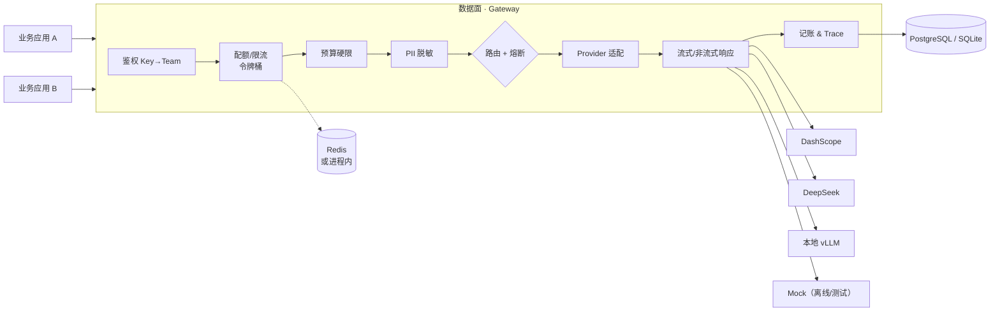
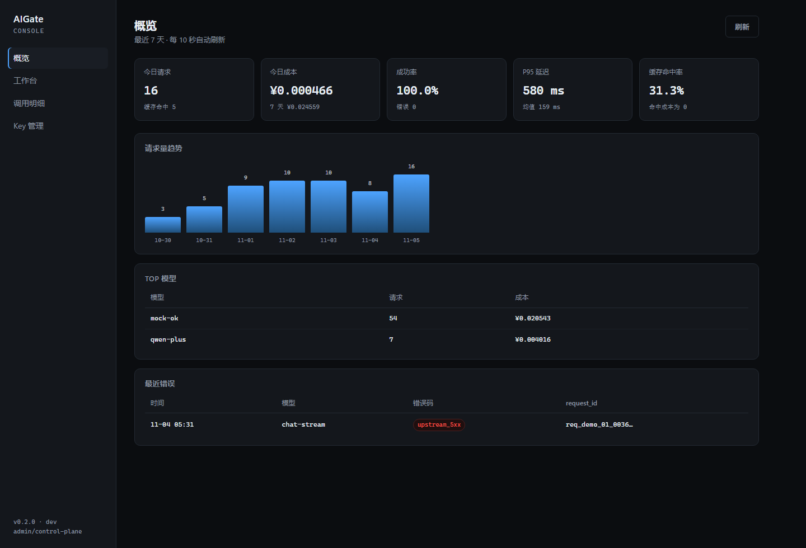
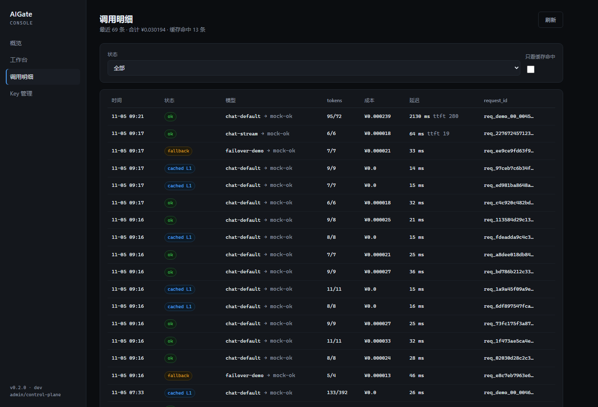
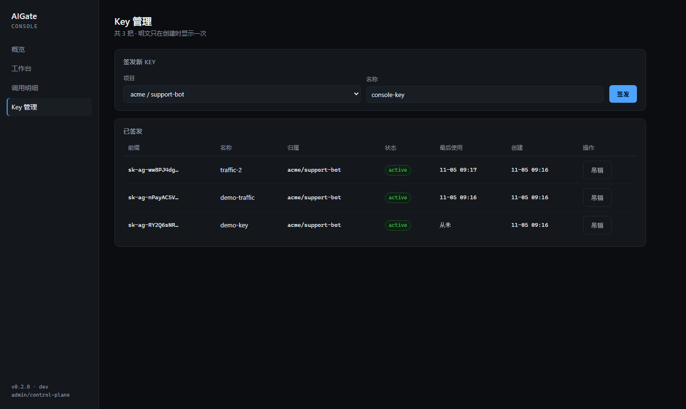
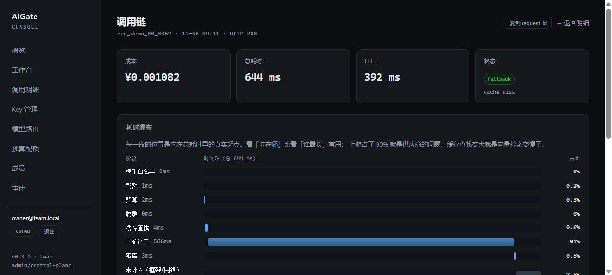
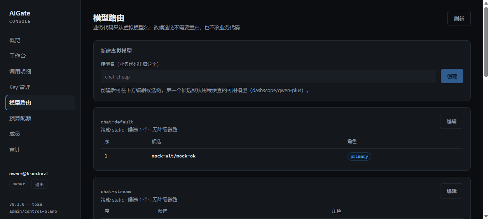
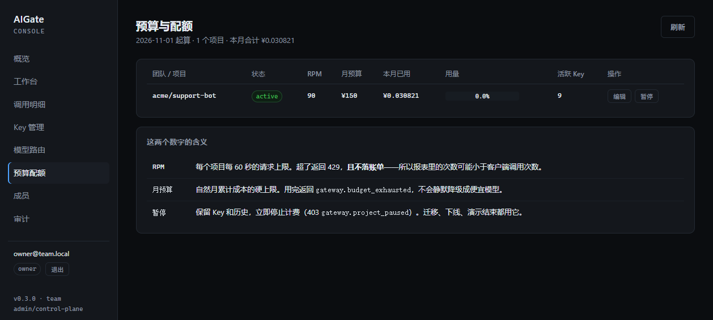
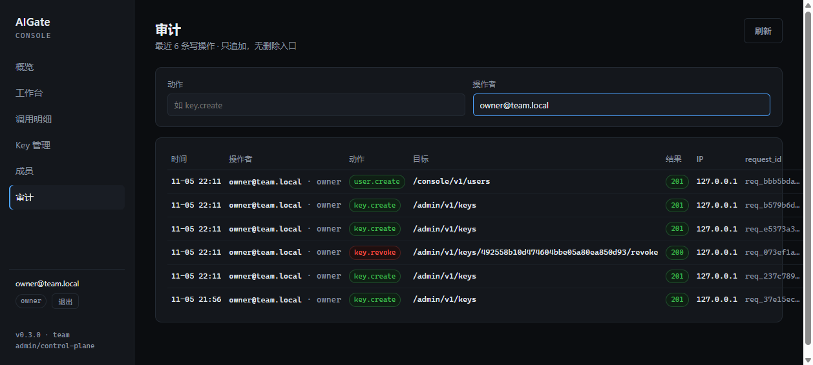
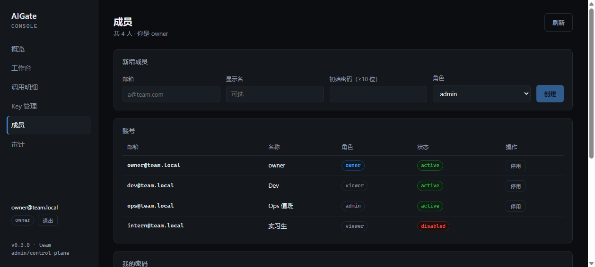
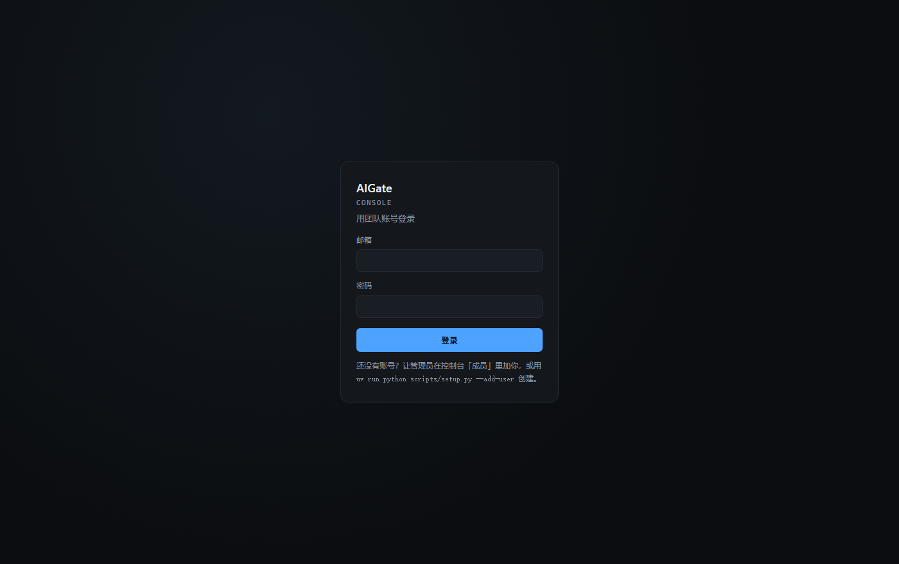

# AIGate

[](https://github.com/Wind-fat/aigate/actions/workflows/ci.yml)
[](LICENSE)
[](pyproject.toml)

**多租户 LLM 网关**：统一接入 · 按团队记账 · 路由与降级 · 熔断 · 流式透传 · 脱敏 · 可观测。

📐 [架构一页纸](ARCHITECTURE.md) · 🚀 [部署](DEPLOY.md) · 📓 [变更记录](CHANGELOG.md) ·
🛠 [参与开发](CONTRIBUTING.md) · 🔒 [安全边界](SECURITY.md) · 🚨 [值班手册](docs/runbook.md) ·
✅ [规格核对表](docs/SPEC-COVERAGE.md) · 🎤 [面试讲法](docs/INTERVIEW.md) · 📊 [质量-成本对照](docs/quality-cost.md)

> 业务方只改一行 `base_url`，就获得鉴权、配额、成本归因、故障降级和全链路追踪。
> 兼容面是**文本补全这一层**：`messages` / `temperature` / `top_p` / `max_tokens` / `stop` /
> `user` / `stream` 会真的转发给上游。网关不转发的字段（`tools`、`response_format`、
> `logprobs`、`n`……）在入口用 400 `gateway.unsupported_parameter` 明确拒绝并列出支持清单——
> 不发 200 让你以为它生效了。
> AIGate 不是聊天工具——它没有聊天界面。它是一个公司**管理大模型资源**的那一层。
>
> 当前形态是**团队内部工具**：一条命令起停、SQLite 起步、带登录/角色/审计的控制台。
> 一个 5–20 人的团队可以直接拿去用；对外提供服务还差的事在文末「已知限制」里逐条列出。

## 已实现 / 待实现

| 能力 | 状态 | 证据 |
|---|---|---|
| OpenAI 兼容 `/v1/chat/completions` | ⚠️ 文本补全层 | `tests/test_param_passthrough.py`（转发 8 个字段，其余 400） |
| 多租户 + API Key（只存 SHA-256） | ✅ | `tests/test_security.py` |
| 虚拟模型 → 候选 + 显式 fallback | ✅ | `failover-demo` 现场可演示 |
| 降级只在**可重试**错误上触发 | ✅ | 4xx 不重试，`test_non_retryable_*` |
| 熔断（连续失败 → 停止调用 → 半开探测） | ✅ | `tests/test_circuit.py` |
| 配额（令牌桶 RPM + 月度预算硬限） | ✅ | `tests/test_quota.py` |
| 流式 SSE 透传 + TTFT 计量 | ✅ | `tests/test_stream.py` |
| PII 脱敏（国内 4 类规则，出网前） | ✅ | `tests/test_guard.py` |
| Decimal 记账（批量异步 + 崩溃可恢复） | ✅ | `tests/test_metering_{writer,spool}.py` |
| Trace（分段耗时 / 路由路径 / 脱敏 prompt） | ✅ | `request_traces` 表 |
| 语义缓存（L1 精确 + L2 向量） | ✅ | 60 次调用实测成本 −66.7% |
| 控制台（Next.js，16 个 `page.tsx`，四角色 + 数据级范围） | ✅ | `docs/screenshots/` |
| 账号 + 三角色（owner/admin/viewer）+ 停用即失效 | ✅ | `tests/test_console_auth.py` |
| 审计（只追加、可指名到人、无删除接口） | ✅ | `/admin/v1/audit` |
| 生产配置校验（占位凭证拒绝启动） | ✅ | `test_production_guard_*` |
| 供应商管理（真实来源 + 一键测连通，密钥不入库） | ✅ | `tests/test_roles_and_providers.py` |
| 角色数据隔离（viewer 只看到自己项目） | ✅ | `test_viewer_is_scoped_to_its_own_project` |
| 评测执行器（smoke + regression 20 例） | ✅ | `make eval`，失败退出码 1 |
| 路由/预算/限流在线编辑（改完下一条请求生效） | ✅ | `tests/test_admin_ops.py` |
| 三种路由策略真实生效（成本 / 延迟 / 指定） | ✅ | `test_cost_first_*` / `test_latency_first_*` |
| 三级配额（team / project / key）+ 日预算 + 80% 告警 | ✅ | `tests/test_spec_gaps.py` |
| prompt 版本（进缓存 key 与账单） | ✅ | `test_prompt_version_is_part_of_the_cache_key` |
| 影子流量（双跑记账、不进客户账单） | ✅ | `test_shadow_runs_are_recorded_but_not_billed` |
| 质量-成本对照 | ✅ | `scripts/quality_cost.py` |
| Grafana 看板 | ✅ | `deploy/grafana/` |
| 运行状态页（熔断/记账队列/数据库/告警） | ✅ | `/ops` |
| 工作台 A/B 对比（双模型并排流式） | ✅ | `/playground` |
| 接入指南 + 错误码表 | ✅ | `/guide` |
| 命令面板（⌘K） | ✅ | 任意页面按 ⌘K |
| 账单 CSV 导出（公式注入转义、行数头） | ✅ | `/admin/v1/usage/export.csv` |
| 调用明细筛选 + 分页 + 跳转调用链 | ✅ | `docs/screenshots/usage.png` |

---

## 为什么不是套壳

判断标准只有一条：**把底层模型换掉，谁会死？**

| | 套壳工具 | AIGate |
|---|---|---|
| 产出物 | 一个聊天界面 | 治理能力（配额 / 账单 / 降级 / trace） |
| 换模型 | 改代码、改 prompt | 改一行路由映射，业务侧无感 |
| 多租户 | 没有 | 团队 → 项目 → Key 三级 |
| 供应商故障 | 整站不可用 | 熔断 + 降级，业务侧只见延迟上升 |
| 能不能被审计 | 不能 | 每次调用可追溯到成本与责任人 |

---

## 架构



**请求路径**

```
鉴权 → 模型白名单 → 令牌桶配额 → 月度预算 → PII 脱敏
     → 路由解析（候选 + 显式 fallback，逐个过熔断）
     → Provider 调用（chat 或 stream）
     → 成本计算 → usage_records + request_traces → 响应
```

两个实现细节值得看：

- **`retryable` 是唯一的降级依据**。超时/5xx/429 才切下一个候选；4xx 一律不重试——重试只是多付一次钱，还掩盖真实错误。
- **流式响应无法回滚**。首 token 前失败可以静默降级；首 token 后只能发一条 `gateway.stream_interrupted` 事件并如实记账。第三条路（假装成功）是错的。

非流式响应带 `x_aigate` 元数据块：

```json
"x_aigate": {
  "request_id": "req_7f3c1a...",
  "team": "acme", "project": "support-bot",
  "provider": "mock", "model_requested": "chat-default", "model_used": "mock-ok",
  "degraded": false, "cache_hit": null, "pii_masked": 1,
  "cost_cny": 0.000042, "priced": true,
  "latency_ms": { "quota_ms": 0, "guard_ms": 0, "upstream_ms": 12, "gateway_total": 14 }
}
```

流式响应没法在 body 里塞元数据（body 是协议），所以尾部追加一条 **SSE 注释**（所有客户端都会忽略注释，这正是它的用处）：

```
: aigate {"request_id":"req_...","provider":"mock","degraded":false,"ttft_ms":31,"cost_cny":0.000018}
data: [DONE]
```

---

## 快速开始（3 分钟，一条命令）

**前置**：Python ≥ 3.11、[uv](https://github.com/astral-sh/uv)、Node ≥ 20（只为控制台）。
无需 Docker、无需数据库服务。

```bash
git clone https://github.com/Wind-fat/aigate && cd aigate
uv sync --all-groups
./scripts/up.sh   # 建 .env（随机 admin token）→ 灌示例数据 → 起网关+控制台 → 开浏览器
```

打开 <http://127.0.0.1:3000>，进「工作台」签一把 Key 就能发请求。Ctrl-C 一起停。
用法详见 **[docs/USAGE.md](docs/USAGE.md)**（接自己的代码、换真实模型、日常看什么）。

```bash
export KEY=sk-ag-xxxx                                  # 控制台「Key 管理」里签发
curl -s localhost:8080/v1/chat/completions \
  -H "Authorization: Bearer $KEY" -H "Content-Type: application/json" \
  -d '{"model":"chat-default","messages":[{"role":"user","content":"hello"}]}' | jq
```

### 四个可现场演示的证据

```bash
# 1) 降级：主候选被故意配置成 500，网关自动切备用
curl -s localhost:8080/v1/chat/completions -H "Authorization: Bearer $KEY" \
  -H 'Content-Type: application/json' \
  -d '{"model":"failover-demo","messages":[{"role":"user","content":"hi"}]}' | jq '.x_aigate.degraded'
# => true

# 2) 流式：SSE 逐块返回，尾部带 TTFT 与成本
curl -sN localhost:8080/v1/chat/completions -H "Authorization: Bearer $KEY" \
  -H 'Content-Type: application/json' \
  -d '{"model":"chat-stream","stream":true,"messages":[{"role":"user","content":"stream"}]}'

# 3) 脱敏：手机号出网前已被掩码（mock 会原样回显，能直接看出有没有漏）
curl -s localhost:8080/v1/chat/completions -H "Authorization: Bearer $KEY" \
  -H 'Content-Type: application/json' \
  -d '{"model":"chat-default","messages":[{"role":"user","content":"call 13812345678"}]}' | jq -r '.choices[0].message.content'
# => [mock:mock-ok] call 138****5678

# 4) 熔断：连打 4 次失败候选，第 4 次主候选根本不会被调用
for i in 1 2 3 4; do curl -s localhost:8080/v1/chat/completions -H "Authorization: Bearer $KEY" \
  -H 'Content-Type: application/json' \
  -d '{"model":"failover-demo","messages":[{"role":"user","content":"hi"}]}' | jq -c '.x_aigate.degraded'; done
```

完整断言脚本：`bash scripts/smoke.sh`（23 项，含数据库副作用校验）。

---

## 评测与压测

### 评测执行器

对**运行中的网关**发真实 HTTP 请求，按 YAML 断言判分：

```bash
uv run python evals/run.py smoke regression --base-url http://127.0.0.1:8080
# verdict: PASS (20/20)   exit 0
```

- 断言不只看状态码：`fallback_attempts` 会反查 `/admin/v1/traces/{id}` 的 `route_path`，
  才能证明「4xx 确实没有触发 fallback」这种**负向**结论。
- 任一用例失败退出码 1，执行器自身出错退出码 2 —— 可以直接挂进 CI。
- 缓存用例带 `{nonce}`，避免热库把「本该 miss」伪装成命中。

### 压测（20 并发 × 200 请求，SQLite 配置）

```bash
uv run python tests/load/loadtest.py --base http://127.0.0.1:8080 --key $KEY \
  --concurrency 20 --requests 200
```

| 实现 | rps | 客户端 p50 | p95 | p99 | 错误 |
|---|---|---|---|---|---|
| 同步记账（改造前） | 42.3 | **238 ms** | 1500 ms | 3216 ms | 2–4 次 500 |
| 批量异步记账（现在） | **51.4** | 365 ms | **597 ms** | **711 ms** | **0** |
| 上游（mock） | — | 15 ms | 22 ms | 27 ms | — |

口径：表里的延迟都是**客户端观测值**（`tests/load/loadtest.py`，20 并发 × 200 请求，
SQLite 单副本，本机）。最后一行是 mock provider 自身耗时，**不是**网关自身开销；网关开销
看 `x_aigate.latency_ms.gateway_total`，本机 p50 约 37 ms（`docs/runbook.md`）。
这两组数字不能互相替代。

**这不是一个纯赢的改造，两个方向都要说：**

- 尾部大幅改善：p95 −60%、p99 −78%，并且 `database is locked` 的 500 归零（正确性 > 延迟）。
- 中位数变差：238 → 365ms。批次的 CPU 工作（构造 100 行 + 编译 executemany）仍在事件循环上，
  形成周期性 head-of-line 阻塞。
- 吞吐只 +22%，因为 SQLite 单写者仍是硬约束——批量只是把「每请求一次锁竞争」换成「每批一次」。

完整推导与后续三条优化路径见 [ADR-0007](docs/adr/0007-batched-metering.md)。

### 值班手册

用法见 [docs/USAGE.md](docs/USAGE.md)；值班处置见 [`docs/runbook.md`](docs/runbook.md)：
限流误触发、熔断打开、缓存错答、记账偏差、DB 锁、供应商区域故障 6 个场景，每个都是「症状 / 先看哪里（具体表或接口）/ 处置命令 / 回滚」。

---

## 控制台

管理后台 + 开发者工作台，同一个 Next.js 应用，`console/app` 下 **16 个 `page.tsx`**
（`find console/app -name page.tsx | wc -l` 就是这句话的口径）：

| 区 | 页面 | 给谁看 |
|---|---|---|
| 管理后台 | 概览 / 调用明细 / 调用链 / Key 管理 / 模型路由 / **供应商** / 预算配额 / 成员 / 审计 | 平台、财务、审计 |
| 工作台 | Playground：选模型、发请求、实时看 `x_aigate` | 接入的开发者、面试演示 |

数一下就对得上 16：表格 9 项 = 10 个 `page.tsx`（「模型路由」拆成 `models/` 与 `routes/`），
另有「告警」「Prompt 版本」「运行状态」「接入指南」4 个后台页，加工作台与登录页。




















启动（网关需先在 8080 运行）：

```bash
uv run python scripts/setup.py --email you@team.local   # 生成 .env + console/.env.local，建 owner
./scripts/up.sh                                          # 起网关 + 控制台，打开浏览器
```

**凭证不进浏览器。** 登录走 `POST /console/v1/login`，网关下发 HttpOnly 签名 cookie
（`uid:exp.HMAC`，无状态、重启不掉线）；Next.js 的 `/api/admin/*` 代理把它原样转发，
浏览器里既没有 admin token 也没有签名密钥。没 cookie 时才回退到服务端 `.env.local` 里的
token（给脚本用）。

三个角色，够用就行：

四个角色，按「他能看到什么」分，不是按「他能不能点」分：

| 角色 | 看得到 | 看不到 |
|---|---|---|
| `viewer`（开发者） | 工作台、**自己项目**的调用明细与调用链、自己项目的 Key 前缀、可用模型 | 成本总览、预算、审计、成员、路由、供应商、别人的 prompt |
| `finance`（财务） | 概览、全部项目的成本与明细、预算、CSV 导出 | prompt 与调用链、Key、路由、供应商、成员、审计 |
| `admin`（平台） | 除「创建/停用 owner」以外的一切 | — |
| `owner` | 全部 | — |

**范围是数据级的，不只是按钮**：`viewer` 的账号绑定了项目范围（`project_scope`），
API 层按它过滤 `usage_records` / `request_traces` / `api_keys`，越界查询返回空而不是报错
（错误信息本身就是情报）。财务虽然有全公司成本，但对调用链是 403——prompt 是客户隐私。

自己的密码在「成员 → 我的密码」改；忘了就让 owner 用 `scripts/setup.py --force` 重设。
开发者账号必须带项目范围，否则它什么都看不到（`gateway.scope_required`）。

**审计是只追加的**：`/admin/v1/*` 与 `/console/v1/*` 的每一次写操作落一行
（actor / role / action / target / status / ip / request_id），没有任何删除或修改接口。
读操作不记——控制台十秒一次轮询会把信号淹掉。actor 由鉴权依赖写进 `request.state`，
所以行里是邮箱，不是一串 id（[ADR-0009](docs/adr/0009-console-accounts.md)）。

`AIGATE_ENV=prod` 时启动会校验凭证：占位 token、过短的 session secret、
`AIGATE_COOKIE_SECURE=false` 任一存在就**拒绝启动**。

截图里的数据由 `uv run python scripts/seed_demo.py` 生成，是**合成数据**：
它有工作日/周末的形状，是为了让图表不至于空着，不代表任何真实业务量。

---

## 语义缓存实测（60 次调用）

`uv run python scripts/bench_cache.py` 会起一个独立网关（专用 `bench.db`），
用同一批 20 个问题跑三遍：冷启动 / 原样重复 / 换个问法。

| pass | calls | hit rate | total cost (CNY) | avg latency |
|---|---|---|---|---|
| cold (no cache) | 20 | 0.0% | 0.000692 | 48.3 ms |
| identical (L1) | 20 | 100.0% | 0.000000 | 31.1 ms |
| paraphrased (L2) | 20 | 100.0% | 0.000000 | 57.2 ms |

**同样 60 次调用：无缓存 ¥0.002076 → 有缓存 ¥0.000692，成本 −66.7%。**

三个必须同时说出来的前提，否则这个数字就是吹的：

1. **命中率是场景相关的**。这里每个问题都重复出现，真实业务重复率可能只有 10–30%，
   成本降幅按同比例缩小。换场景就要重测，不能搬数字。
2. **L1 更快（31ms），L2 更慢（57ms）**。L2 要算 embedding 再扫库。这里上游是 10ms 的
   mock，缓存开销显得刺眼；接真实模型（800ms+）时结论会反过来。说"缓存一定更快"是错的。
3. 金额用 mock 单价算，绝对值没意义，**比例**才有意义。

缓存只对**确定性单轮请求**生效：`temperature=0`、无 assistant 轮次、非流式。
（`tools` 在入口就 400，走不到缓存这一步。）
降级（fallback）产生的答案不写缓存——它来自备用模型，缓存它等于把较低质量的结果钉住一整天。

---

## 接入真实模型

改 `.env`，把某个候选指向真实供应商（三家都走 OpenAI 兼容协议，一个适配器即可）：

```bash
AIGATE_DEFAULT_PROVIDER=dashscope
AIGATE_DASHSCOPE_API_KEY=sk-xxx
```

然后改 `route_policies` 的候选为 `{"provider":"dashscope","model":"qwen-plus"}`。
没有真实 key 时，`mock` 保证整套链路（鉴权、配额、降级、熔断、流式、记账、trace）**始终可运行**——这也是它存在的理由。

---

## API

| 方法 | 路径 | 说明 | 鉴权 |
|---|---|---|---|
| POST | `/v1/chat/completions` | OpenAI 兼容（文本补全层，参数白名单见下）；`stream=true` 走 SSE | Bearer API Key |
| GET | `/v1/models` | 当前 Key **有权调用**的模型 | Bearer API Key |
| GET | `/health` `/ready` `/metrics` | 存活 / 就绪 / Prometheus 指标 | 无 |

**请求参数是白名单**（`src/aigate/schemas.py:SUPPORTED_PARAMS`）：

| 字段 | 网关怎么处理 |
|---|---|
| `model` | 虚拟模型 → 候选链，决定这次调用打到哪个 provider |
| `messages` | 出网前 PII 脱敏后原样转发；只有 `role/content/name` 会用上 |
| `temperature` / `top_p` / `max_tokens` | 原样进上游 body（`None` 不写键，不补 `null`） |
| `stop` | 字符串或字符串数组，原样转发 |
| `user` | 原样转发（厂商侧的终端用户标识） |
| `stream` | `true` 走 SSE |
| `stream_options` | 只认 `{"include_usage": true}`，且**不转发**：网关自己始终向上游要 `include_usage`（计量口径），这个键决定**客户端**是否也拿到一个 usage chunk。其他键 400 |

其余字段（`tools` / `tool_choice` / `response_format` / `logprobs` / `n` /
`presence_penalty` / `frequency_penalty` / `seed` …）**没有转发路径，所以直接 400**：

```json
{
  "error": {
    "code": "gateway.unsupported_parameter",
    "message": "unsupported parameter(s): tools. This gateway forwards only: messages, model, ...",
    "unsupported_parameters": ["tools"],
    "supported_parameters": ["model", "messages", "temperature", "top_p", "max_tokens", "stop", "stream", "stream_options", "user"]
  }
}
```

拒绝发生在配额与记账之前：参数写错不会产生 `usage_records` 行，也不会花掉一次上游调用
（`test_refusal_costs_nothing_in_metering`）。`top_p` 越界给 `gateway.invalid_parameter`，
不把厂商的 400 原样透出去。`stream_options` 里出现未知键给
`gateway.unsupported_parameter`（`stream_options.chunk_size` 这种全名进 `unsupported_parameters`），
`include_usage` 不是布尔值给 `gateway.invalid_parameter`。

**响应侧（`finish_reason` 与 usage）——支持什么、不支持什么**：

| 响应内容 | 网关行为 | 明确的限制 |
|---|---|---|
| `choices[].finish_reason`（非流式 + 流式） | 上游给了就**原样透传**：`stop` / `length` / `content_filter` / `tool_calls` / 厂商自有字符串都照抄。上游给空串、`"null"`、`"none"`、`"unknown"` 时按 `max_tokens` 与 `completion_tokens` 推导：打满 → `length`，没打满 → `stop` | 推导是**启发式，不是 OpenAI 语义**：厂商既不给 reason 又不给 token 数时，被截断的答案仍会报 `stop`。不会伪造 `tool_calls`（`tools` 入口就 400） |
| `usage`（非流式） | 始终是 OpenAI 三字段形状；`x_aigate.usage_source` 写明来源：`upstream`（厂商报了）/ `missing`（厂商没报，数值为 0） | 厂商没报就是全 0 + `missing`；不估算、不假装 |
| `usage`（流式） | `stream_options: {"include_usage": true}` → 在 `finish_reason` chunk 之后、`[DONE]` 之前多发一个 `{"choices": [], "usage": {...}}`，顺序与 OpenAI 一致；**不传则一个 usage chunk 都不发**，`data:` 帧与改动前一致（只有网关自己的 `: aigate` 注释多了 `finish_reason`/`usage_source` 两个键，SDK 不读它） | 厂商不给 usage 时用字符估算，并在 `: aigate {...}` 注释里标 `usage_source: "estimated"`（部分给就是 `"mixed"`）。没有逐 token 的 usage 增量 |
| 缓存命中（非流式） | `finish_reason` 恒为 `stop`，而且这句话是真的：只有 `stop` 的答案才进缓存 | 缓存表不存 `finish_reason`，所以被截断的答案不缓存 |
| 流中断 | 发 `gateway.stream_interrupted` 事件后 `[DONE]`；**不补** `finish_reason`，也不补 usage chunk | 首 token 之后无法回滚 |

**统一错误码**（调用方据此决策，不必读文档）：

```
gateway.missing_credentials · gateway.invalid_key · gateway.model_not_allowed
gateway.quota_exceeded · gateway.budget_exhausted · gateway.stream_interrupted
gateway.stream_unsupported · gateway.unsupported_parameter · gateway.invalid_parameter
upstream_timeout · upstream_5xx · upstream_4xx
upstream_rate_limited · upstream_stream_error
```

---

## 配置（环境变量，前缀 `AIGATE_`）

| 变量 | 默认 | 说明 |
|---|---|---|
| `AIGATE_DATABASE_URL` | `sqlite+aiosqlite:///./aigate.db` | 生产用 `postgresql+asyncpg://...` |
| `AIGATE_ADMIN_TOKEN` | `dev-admin-token` | 控制面管理令牌 |
| `AIGATE_DEFAULT_PROVIDER` | `mock` | 无匹配路由时的兜底 provider |
| `AIGATE_DEFAULT_RPM` | `60` | 项目未单独配置时的每分钟请求上限 |
| `AIGATE_RATE_LIMITER` | `memory` | `memory`（单进程）/ `redis`（多副本共享额度） |
| `AIGATE_CIRCUIT_BACKEND` | 空 | 熔断后端；留空跟随 `rate_limiter`。多副本必须一起切 redis |
| `AIGATE_REDIS_URL` | `redis://127.0.0.1:6379/0` | `rate_limiter=redis` 时生效 |
| `AIGATE_CIRCUIT_THRESHOLD` | `3` | 连续可重试失败多少次后熔断 |
| `AIGATE_CIRCUIT_COOLDOWN_S` | `30` | 熔断后多久允许一次半开探测 |
| `AIGATE_REQUEST_TIMEOUT_S` | `30` | 上游超时（秒） |
| `AIGATE_SEMANTIC_CACHE_ENABLED` | `true` | 语义缓存开关 |
| `AIGATE_CACHE_THRESHOLD` | 空 | 相似度阈值；空 = 用 embedder 的校准值（hash 0.65 / api 0.92） |
| `AIGATE_CACHE_TTL_S` | `86400` | 缓存条目存活时间 |
| `AIGATE_CACHE_MAX_SCAN` | `2000` | L2 每次最多扫描多少条（暴力检索的上限） |
| `AIGATE_PROMPT_VERSION` | `v1` | 默认 prompt 版本；请求可用 `X-Prompt-Version` 覆盖，参与缓存 key |
| `AIGATE_TRACE_PROMPT_MODE` | `masked` | 设为 `raw` 才保存用户原文（默认只存脱敏文本） |
| `AIGATE_TRACE_PROMPT_MAX_CHARS` | `4000` | raw 模式下的截断长度 |
| `AIGATE_DASHSCOPE_*` / `AIGATE_DEEPSEEK_*` / `AIGATE_VLLM_*` | — | 各供应商 base_url 与 key |

---

## 测试

```bash
bash scripts/accept.sh   # 一条命令跑完全部验收（lint + 275 项单测 + 23 项冒烟 + 部署接线）
make accept        # 同上，装了 make 的话
make verify        # ruff + pytest
bash scripts/smoke.sh   # 真起进程的端到端 23 项断言
uv run python scripts/check_deploy.py --env-file .env.production   # 不用 Docker 也能验的部署检查
```

测试全部走 `mock` / `mock-alt` 两个离线 provider，不触网、不需要 key、可离线跑。

```
tests/
├── test_security.py       # key 生成 / 哈希 / 格式
├── test_metering.py       # Decimal 成本、token 估算
├── test_guard.py          # 4 类 PII 规则、幂等性、出网前脱敏
├── test_quota.py          # 令牌桶语义、429 且不产生上游调用、预算硬限
├── test_stream.py         # SSE 帧、TTFT、首 token 前降级、流中断不可恢复
├── test_circuit.py        # 熔断单元 + 打开后不再调用死掉的供应商
├── test_cache.py          # 准入规则、L1/L2、租户隔离、降级不缓存
├── test_admin.py          # 控制面鉴权、聚合口径、Key 生命周期
├── test_console_auth.py   # 密码哈希、会话签名、角色越权、审计归属、生产校验
└── test_chat_endpoint.py  # 鉴权 401 / 越权 403 / 降级 / 记账一致性
```

---

## 已知限制（写出来，而不是藏起来）

- **兼容面只有文本补全**：网关转发 `messages`/`temperature`/`top_p`/`max_tokens`/`stop`/`user`/`stream`，
  外加本地兑现的 `stream_options.include_usage`；其余 OpenAI 字段（`tools`、`tool_choice`、`response_format`、
  `logprobs`、`n`、`presence_penalty`、`seed` …）没有转发路径，入口直接 400 `gateway.unsupported_parameter`。
  所以「任何 OpenAI SDK 只改 base_url」只对纯对话/补全成立；带 function calling 的代码接进来会拿到明确的 400，
  而不是一个没有 `tool_calls` 的正常答案。要支持 tools，必须同时改 `providers/base.py` 的签名、
  `openai_compat._build_payload`，以及响应侧的 `tool_calls` 透传（流式还要处理 `delta.tool_calls`）。
- **响应侧的两处承诺要看清边界**（细节见上文「响应侧」表，测试在 `tests/test_response_fidelity.py`）：
  ① `finish_reason` 以上游为准，上游不说时按「`completion_tokens` 是否打满 `max_tokens`」推导——这是**启发式**，
  厂商既不给 reason 又不给 token 数时，截断仍会显示 `stop`；② 流式 usage 只在调用方显式传
  `stream_options: {"include_usage": true}` 时出现，且厂商不给用量时是字符估算（注释里标 `usage_source`），
  不是 tokenizer 口径。
- **熔断/限流已支持多副本**（`AIGATE_RATE_LIMITER=redis` + `AIGATE_CIRCUIT_BACKEND`，[ADR-0012](docs/adr/0012-multi-replica-state.md)）。
  注意：Redis 实现只验证到协议层（假客户端），本机没有 redis-server，真实网络行为未实测。
- **熔断按 provider 粒度**：`mock` 熔断会连带跳过所有路由到 `mock` 的策略。生产里 fallback 应指向**另一家**供应商，否则等于没有 fallback。
- **流式响应无法回滚**：首 token 后上游挂掉，只能发 `gateway.stream_interrupted` 并如实记账，不能假装成功。
- 表结构：Alembic 全量迁移（`alembic upgrade head`），启动时仍会 `create_all` 兜底，两者共存。
- **语义缓存用 JSON 存向量 + 暴力余弦**（万级以下 <10ms）。pgvector 索引留到有 PG 环境时替换，
  接口已隔离（ADR-0005）。这是有意识的选择，不是没做完。
- **阈值必须跟着 embedding 模型走**：hash embedding 的相似度分布整体偏低（同义句 ~0.71），
  直接套 bge-m3 的 0.92 会让离线缓存永远不命中。所以阈值挂在 embedder 上，配置项留空即用校准值。
- **L2 命中可能比不缓存更慢**，见上文实测表。
- **供应商密钥是单主密钥加密**（`AIGATE_SECRET_KEY`），没有 KMS/HSM、没有自动轮换、没有按租户分密钥
  （[ADR-0011](docs/adr/0011-provider-secrets.md)）。够内部团队用，不够对外当 SaaS。
- **记账已做到崩溃可恢复**：先写 NDJSON spool 再入队，提交后 ack，启动时回放并按
  `request_id` 去重。进程被 `kill -9` 不丢账；断电可能丢最后几毫秒（[ADR-0008](docs/adr/0008-durable-metering-spool.md)）。
- **SQLite 单写者仍是并发上限**：批量记账把 p95 从 1.5s 压到 0.6s、错误归零，但吞吐只
  从 42 涨到 51 rps。下一步是把批次写移出事件循环 / 换 PostgreSQL，见 ADR-0007。
- 压测脚本默认阈值（p95 ≤ 800ms）是 **PostgreSQL 口径**；在 SQLite 演示配置下用
  `--max-p95-ms 2000` 才是合理断言。这两个数字都写在 README 里，不藏。
- **控制台是单机账号体系**：没有 SSO、没有 2FA、没有密码重置邮件（忘了就让 owner 重设）。
  会话是签名 cookie，吊销靠每请求查 `status`，所以没有 Redis 也能立刻停用一个人。
- **审计只记 HTTP 层的写操作**：直接改数据库不会留痕。真正的防篡改要靠追加写的外部日志（WORM）。
- **路由写入只拦「未注册的 provider」**：模型名写错但 provider 已注册时只给告警（成本按 0 记），
  因为离线 mock 和刚接入的模型本来就没有单价行。告警会显示在控制台。
- **Compose 栈没有在真机上跑过**（开发机无 Docker）。替代方案是 `scripts/check_deploy.py`：
  校验构建上下文、COPY 源文件、必填环境变量、端口冲突、健康检查依赖，CI 里每次推送都跑。
- **账号限流与业务共用同一个 token bucket**：登录爆破被挡住，代价是同一个 IP 的登录会消耗调用配额。
- 控制台的聚合在 Python 里算：万级以下无感，百万级要落物化日表或换 OLAP。

---

## 目录

```
src/aigate/
├── main.py            # app 工厂、中间件顺序（含审计）、异常归一化
├── console_auth.py    # scrypt / HMAC 会话 / Actor
├── audit.py           # 只追加的写操作审计（actor 由依赖写入 request.state）
├── provider_config.py # 供应商配置（密钥只在环境变量里）+ 5 秒缓存
├── config.py          # 所有配置唯一入口
├── db.py              # 引擎懒加载（测试可换库）
├── models.py          # 7 张表
├── guard.py           # PII 规则（出网 + trace 共用同一套）
├── metering.py        # Decimal 成本 / token 估算
├── metrics.py         # Prometheus 文本指标
├── core/
│   ├── quota.py       # 令牌桶（memory/redis+Lua）+ 月度预算
│   ├── circuit.py     # 熔断：closed → open → half-open
│   ├── embedding.py   # hash（离线）/ API（bge-m3），阈值随 embedder 校准
│   └── cache.py       # 语义缓存 L1 精确 + L2 向量，含准入规则
├── providers/         # base(ABC) + openai_compat + mock（两个实例）
└── api/               # deps / health / v1_chat
```

---

## Roadmap

- [x] **Stage 1** 骨架、鉴权、路由、降级、记账、Trace
- [x] **Stage 2** 令牌桶配额、预算硬限、流式 SSE、PII 脱敏、熔断、40 项测试
- [x] **Stage 3a** 语义缓存（L1/L2 + embedder 抽象 + 成本对照脚本）、50 项测试、23 项冒烟
- [x] **Stage 3b** 控制台（Next.js）+ `/admin/v1` 控制面 API
- [x] **Stage 3c** Alembic 迁移（2 个 revision / 10 张表，upgrade / downgrade / PG 离线 DDL 已验证）
- [x] **Stage 4** 评测执行器（20 例）+ 压测脚本（Python / k6）+ 值班手册
- [x] **Stage 5** 批量异步记账（p95 −60%、错误归零，代价见 ADR-0007）
- [x] **Stage 5b** 记账落盘 + 回放去重（`kill -9` 不丢账，见 ADR-0008）
- [x] **Stage 6** 团队账号（三角色）、签名会话、只追加审计、生产配置校验（ADR-0009）
- [x] **Stage 7** 业务闭环：预算/限流/路由在线编辑、明细筛选分页、CSV 导出、调用链瀑布、部署静态检查
- [ ] **Next** 写入移出事件循环、预算聚合 TTL 缓存、pgvector 索引、SSO、演示视频

设计决策见 [`docs/adr/`](docs/adr/)：
[0001 技术选型](docs/adr/0001-stack-choices.md) ·
[0002 为什么不用 LiteLLM](docs/adr/0002-why-not-litellm.md) ·
[0003 限流后端](docs/adr/0003-rate-limiter-backends.md) ·
[0004 熔断粒度](docs/adr/0004-circuit-breaker-granularity.md) ·
[0005 语义缓存](docs/adr/0005-semantic-cache-before-pgvector.md) ·
[0006 控制台取舍](docs/adr/0006-console-tradeoffs.md) ·
[0007 批量记账](docs/adr/0007-batched-metering.md) ·
[0008 记账落盘](docs/adr/0008-durable-metering-spool.md) ·
[0009 账号体系](docs/adr/0009-console-accounts.md)

---

## License

Apache-2.0